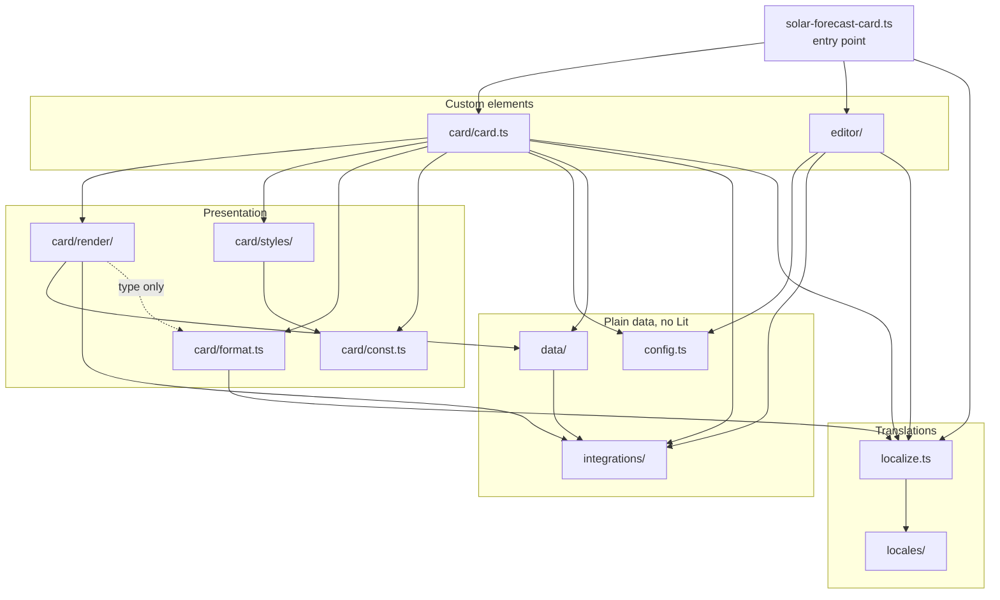
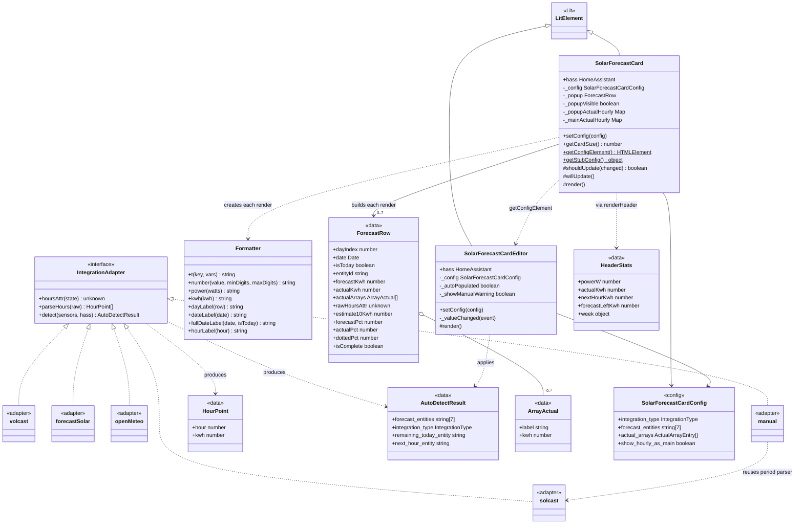
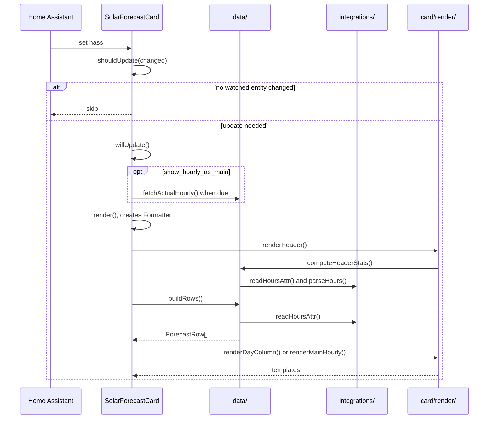
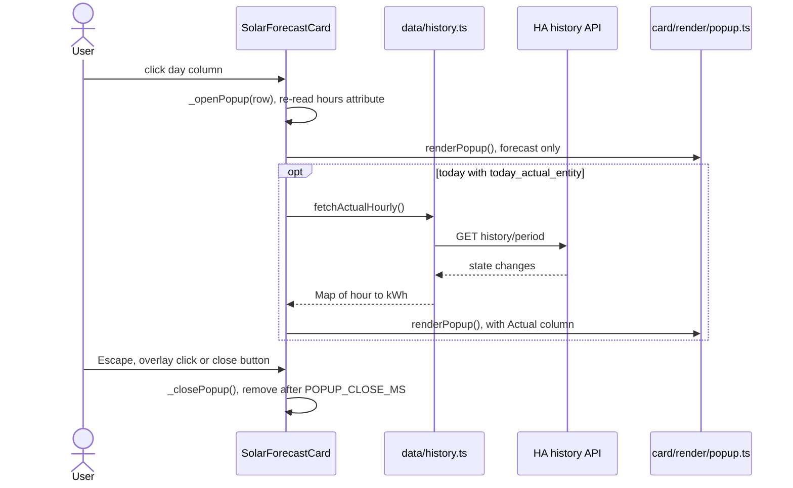

# Developer Guide

How the card is built, how to work on it, and how to extend it. For installing and configuring the card, see the [README](../README.md).

The card is a [Lit](https://lit.dev/) custom element written in TypeScript. Rollup bundles it into a single file, `dist/solar-forecast-card.js`, which Home Assistant loads as a Lovelace resource.

## Quick start

You need Node.js 20.

```bash
npm ci                 # install exact dependency versions
npm run dev            # rebuild on change
npm test               # run the unit tests
npm run typecheck      # type-check without emitting
npm run build          # validate locales and build dist/
```

Without Node installed locally, run the same commands in the official image:

```bash
docker run --rm -v "$PWD:/app" -w /app node:20 sh -c 'npm ci && npm run build'
```

To try a build in Home Assistant, serve `dist/solar-forecast-card.js` and add it as a dashboard resource of type *JavaScript module*. Change the URL's `?v=` value after each build, or the browser may keep the cached version.

## Project layout

```text
src/
├── solar-forecast-card.ts   Entry point: loads both elements, registers with Lovelace
├── config.ts                normalizeConfig: defaults and sanitising
├── types.ts                 Config and Home Assistant types
├── localize.ts              Translation lookup and language resolution
├── locales/                 One JSON file per language, plus the table in index.ts
├── integrations/            One adapter per forecast integration
├── data/                    Reads Home Assistant state into plain data
├── card/
│   ├── card.ts              <solar-forecast-card>: state, lifecycle, popup
│   ├── format.ts            Formatter: numbers, units, dates, translations
│   ├── const.ts             Timing constants shared by code and CSS
│   ├── render/              Functions that return Lit templates
│   └── styles/              CSS, split to match render/
└── editor/
    ├── editor.ts            <solar-forecast-card-editor>
    ├── form-data.ts         Config ↔ flat ha-form data
    ├── schema.ts            ha-form schemas
    └── styles.ts
tests/                       Unit tests (vitest)
scripts/validate-locales.cjs Checks every locale has the same keys as en.json
dist/                        Built bundle, committed so HACS can install it
```

## Architecture

### Module dependencies

Dependencies point one way, from the elements down to plain data. `integrations/` and `data/` don't import Lit, which is why they can be unit tested without a DOM.

Keep it this way: `data/` must not import from `card/`, and `integrations/` must not import from `data/`. `types.ts` is imported nearly everywhere, so it is left off the diagram.



### Classes and data types

Each integration is a plain object that implements `IntegrationAdapter`. Only `integrations/index.ts` picks between them, so the rest of the code never branches on integration type for parsing.

The `render*` functions in `card/render/` aren't classes, so they don't appear here. They take data and a `Formatter`, and return templates.



Fields that can be `null` or `undefined` are shown as their base type. See the TypeScript definitions for exact types.

### Render cycle

Home Assistant assigns a new `hass` object on every state change anywhere in the system, so `shouldUpdate` filters out changes to entities the card doesn't use.

Data fetching and state changes belong in `willUpdate`. `render()` must stay free of side effects: state written there triggers another update.



### Opening the popup

Clicking a day re-reads that entity, so the popup always shows the latest hourly data. For today, the chart first renders forecast-only, then adds the Actual column when the history response arrives.



### Design rules

- **One shadow root.** Views are functions that return templates, not child elements. Nested shadow roots would break the `part=` attributes and existing card-mod selectors.
- **One bundle.** All locales and the editor ship in one file. HACS and Lovelace resources expect a single file, and the bundle gzips to well under 100 KB.
- **CSS order matters.** `desktopScaleStyles` overrides base sizes at equal specificity, so it must stay last in `card/styles/index.ts`.
- **All energy is kWh internally.** Read sensors through `readKwh` in `data/entities.ts`, which converts Wh. Don't call `parseFloat` on an entity state directly.
- **`normalizeConfig` is a whitelist.** Keys it doesn't list are dropped.

## Common tasks

### Add a forecast integration

1. Add the name to `IntegrationType` in `src/types.ts`.
2. Create `src/integrations/<name>.ts` exporting an `IntegrationAdapter`:
   - `hoursAttr` returns the attribute holding hourly data.
   - `parseHours` returns points sorted by hour, in kWh, with `trimZeroHours` or equivalent applied. It never receives `null` or `undefined`.
   - `detect` returns `null` unless the sensors belong to this integration. Check with `hasPlatform`.
3. Register it in `ADAPTERS` in `src/integrations/index.ts`, and in `PLATFORM_ADAPTERS` if it has `detect`.
4. Add a dropdown option in `integrationSchema` in `src/editor/schema.ts`.
5. Add the option's `editor.options.*` label to **every** locale file.
6. Add parser and detection tests to `tests/integrations.test.ts`.

If the integration has no hourly data, follow `forecast_solar`, which is also special-cased in `card/card.ts` and `card/render/hourly-chart.ts`.

### Add a config option

1. Add the field to `SolarForecastCardConfig` in `src/types.ts`.
2. Copy it through in `normalizeConfig` in `src/config.ts`.
3. Add it to `FormData`, `toFormData` and `fromFormData` in `src/editor/form-data.ts`.
4. Add it to a schema in `src/editor/schema.ts`. If the schema is new, render it in `src/editor/editor.ts`.
5. Add its `editor.labels.<name>` label to every locale file.
6. If the card must re-render when an entity option changes, add it to `watchIds` in `shouldUpdate` in `src/card/card.ts`.
7. Document it in the README.

### Add or change translations

Every locale must have exactly the same keys as `en.json`. `npm run build` fails otherwise.

- **New key:** add it to all files in `src/locales/`. Use the English text if you have no translation.
- **New language:** add `<code>.json`, then import it and add it to `LOCALES` in `src/locales/index.ts`. That table is the only list of languages; the type, the language options and the validator all derive from it.

### Add a sensor read

Use the helpers in `src/data/entities.ts`: `readKwh`, `readPowerW`, `readArrayActuals` and `resolveActualKwh`. The bars and header use the same functions, which is what keeps them in agreement.

## Testing

```bash
npm test                                    # all tests
npx vitest                                  # watch mode
npx vitest run tests/integrations.test.ts   # one file
TZ=Asia/Kolkata npm test                    # a specific timezone
```

| File | Covers |
|------|--------|
| `tests/integrations.test.ts` | Attribute selection, parsers, device auto-detection |
| `tests/data.test.ts` | Sensor reads, rows, colour tiers, header stats, history |
| `tests/config.test.ts` | `normalizeConfig` and editor form data |
| `tests/localize.test.ts` | Language resolution, translation lookup, locale table |
| `tests/timezone.test.ts` | How each parser resolves the hour |

`card/` and `editor/editor.ts` have no automated tests, so check rendering and the editor by hand in Home Assistant. Test payloads are hand-written from the documented formats, not captured from live integrations.

## Continuous integration

| Check | Runs | Fails when |
|-------|------|------------|
| `Typecheck and build` | Every push and PR | Types or locales are invalid, the build fails, or the committed `dist/` differs from a fresh build |
| `Test (UTC)`, `Test (America/New_York)`, `Test (Asia/Kolkata)` | Every push and PR | Any unit test fails in that timezone |
| `HACS Action` | Every push and PR, and daily | The repository doesn't meet HACS requirements |

The first four checks are required on `main` by the *Require CI on main* ruleset. Check names must match exactly, so renaming a CI job or changing the timezones means updating the ruleset too.

Dependabot proposes npm and GitHub Actions updates weekly. Because `lit` is bundled into the card, a PR that updates it must also include a rebuilt `dist/`.

## Before you commit

```bash
npm run typecheck
npm test
npm run build
```

Commit the rebuilt `dist/solar-forecast-card.js` with your source changes, or CI will fail.

## Known limitations

- **Solcast hours follow the browser's timezone.** Volcast and Open-Meteo use the hour written in the timestamp. Viewing the dashboard from a different timezone than the server shifts the Solcast chart and the `+1HR` and `LEFT` values.
- **Threshold sensors don't trigger a re-render.** `low_threshold_entity` and `high_threshold_entity` are missing from `watchIds` in `shouldUpdate`, so bar colours update only when another watched entity changes.
